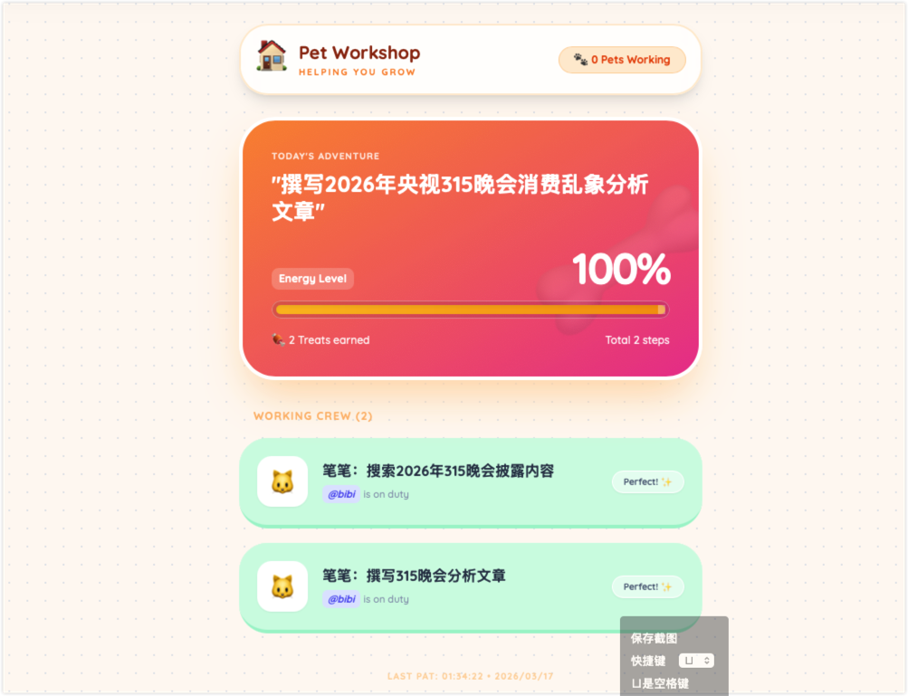

[](https://opensource.org/licenses/MIT)
[](https://ifdian.net/a/noahtan)

# Skills_Repo

Noah和他的AI助理们开发的skills仓库，全部开源，欢迎取用。如果你觉得对你有帮助，可以帮我买杯咖啡，感谢~~

A skill repository developed by Noah and his AI assistants. All open source, feel free to use. Buy me a coffee if you find it helpful :) Thanks~~

## 技能列表 / Skills

### 核心工具 / Core Tools

#### longtask_system
- **技能名称 / Name**：长程任务管理系统 / LongTask System
- **技能描述 / Description**：状态驱动的任务编排引擎，用于管理跨会话的复杂工作流，**支持可视化驾驶舱实时监控** / State-driven task orchestration engine for managing complex workflows across sessions, with **visual cockpit for real-time monitoring**
- **当前版本 / Version**：1.2.2
- **发布日期 / Date**：2026-03-24



#### ec_creator
- **技能名称 / Name**：执行卡片创建工具 / EC Creator
- **技能描述 / Description**：EC校验和自动修复工具，用于创建标准化执行卡片 / Validation and auto-fix tool for creating standardized Execution Cards
- **当前版本 / Version**：1.1.0
- **发布日期 / Date**：2026-03-15

#### company-name-check
- **技能名称 / Name**：企业字号核验 / Company Name Check
- **技能描述 / Description**：给一批候选公司名，判断能不能过工商核验、有没有撞上别人的品牌或商标。双通道：国家市场监管总局名称开放查询（免登录，弱初筛）+ 北京 e 窗通名称开放查询（复用已登录浏览器会话，判别力强）。自动处理算式验证码、token 链式刷新与限流重试，内置品牌词库单独标注 IP 冲突，输出字号核验与品牌/IP 两列判定 / Batch-check candidate company names against official name registries and flag brand/trademark collisions. Two channels: SAMR open name query (no login, weak pre-screen) and Beijing e-window open query (reuses a logged-in browser session, far more discriminative). Handles arithmetic CAPTCHAs, chained tokens and rate limits; ships a brand watchlist and reports registry and IP verdicts as separate columns
- **当前版本 / Version**：1.0.0
- **发布日期 / Date**：2026-11-09
- **安装 / Install**：`pip install -r skills/company-name-check/requirements.txt`，另需系统 Chrome 与 `tesseract`；全国通道 `python3 scripts/check_national.py 字号A 字号B --trade 科技`，北京通道 `python3 scripts/check_beijing.py 字号A 字号B --profile <已登录Chrome配置目录> --trade 科技`，品牌扫描 `python3 scripts/brand_scan.py --json 结果.json`
- **验证 / Verify**：内置对照实验（腾讯 / 阿里巴巴 / 蓝宇），实测同名字在两通道判别力差 200 倍（蓝宇：总局 1 条 vs 北京 209 条），可据此判断通道是否正常
- **边界 / Limits**：开放库为字符包含匹配，0 条不等于工商必然通过（读音、字形近似需「名称自主申报」终判）；商标终判须登录中国商标网按第 9/35/42 类检索，脚本不代查；官方站点对高频请求敏感，禁止批量刷

#### scribe
- **技能名称 / Name**：本地录音转写 / Local Audio Transcription
- **技能描述 / Description**：音频/视频 → 带时间戳文字稿（TXT/SRT/JSON），可选说话人标记（CAM++）。常驻本地服务，**Agent 可自动调用**（上传转写 + 下载留存全自动闭环）。自包含跨平台：代码全在 skill 内，首次 setup.py 自动装依赖 + 下载模型 / Audio/video → timestamped transcript (TXT/SRT/JSON), optional speaker diarization (CAM++). Persistent local service with **full Agent automation** (upload → transcribe → download loop). Self-contained & cross-platform: all code in skill, setup.py installs deps + downloads models on first run
- **当前版本 / Version**：1.0.0
- **发布日期 / Date**：2026-08-25
- **安装 / Install**：`python3 scripts/setup.py`（跨平台：venv + funasr/torch + SenseVoice 模型 897MB，modelscope 国内源）；启动 `python3 scripts/start.py`；Agent 调用 `python3 scripts/scribe.py <音频> [--diarize]`

#### glm-vision
- **技能名称 / Name**：智谱视觉理解 / GLM Vision Understanding (Image + Video)
- **技能描述 / Description**：智谱 GLM-5.3-flash 视觉理解 CLI。图片（本地路径自动转 Base64 / URL 直传 / 多图对比）+ 视频（本地自动转 Base64 / URL 直传）进，文字或 JSON 分析出。支持 OCR 式文字提取、图表解读、截图理解、多图对比。模型、端点、API Key 全部 config.json 可换（Coding Plan 与标准端点均可用）。国外图片 URL 拉取失败时 `--download` 自动降级本地转 Base64 / Zhipu GLM-5.3-flash vision CLI. Images (local auto-Base64 / URL / multi-image compare) + videos (local auto-Base64 / URL) in, text or JSON analysis out. OCR extraction, chart reading, screenshot understanding, multi-image compare. Model/endpoint/key all config-swappable (both Coding Plan & standard endpoint verified). `--download` fallback converts foreign URLs to Base64 locally when server-side fetch fails
- **当前版本 / Version**：1.2.0
- **发布日期 / Date**：2026-09-08
- **安装 / Install**：填入你的智谱 API key 到 `skills/glm-vision/config.json`（或设环境变量 `GLM_VISION_API_KEY`），然后 `python3 skills/glm-vision/scripts/glm_vision.py image.jpg --prompt "描述内容"` 或 `python3 skills/glm-vision/scripts/glm_vision.py video.mp4 --json --prompt "..."`；多图：`glm_vision.py img1.jpg img2.png --prompt "对比"`
- **限制**：图片 ≤10MB；视频 ≤50MB；国外 URL 源智谱服务端拉取易失败（加 `--download` 本地下载绕过）；并发约 5 QPS；空回答时加大 --max-tokens（推理占额）

#### geopulse
- **主开发仓库 / Primary repository**：[noah-1106/geopulse](https://github.com/noah-1106/geopulse)（公开）；`skills/geopulse` 保留 v2.5 分发镜像，后续开发、Issue、CI 和 Release 以独立仓库为准
- **技能名称 / Name**：自托管多客户 GEO 交付工作台 / Self-hosted Multi-client GEO Delivery Workbench
- **技能描述 / Description**：完整前后端自包含，覆盖问题与实体口径、跑前准备单、可恢复 Wave/Run 测量、独立 Judge 与 Judge-only 补判、严格同口径比较、Intervention 证据链、只读交付 handoff、不可变报告，以及权限、调度、成本和备份。支持 Demo、OpenAI-compatible、Kimi/DeepSeek Search + Chat、人工 Consumer Web 和授权 DeepSeek/Kimi 网页采集；API 与消费端观察始终分开
- **当前版本 / Version**：2.5.0
- **发布日期 / Date**：2026-11-10
- **安装 / Install**：主开发请克隆独立仓库；使用本快照可运行 `cd skills/geopulse && python3 -m venv .venv && .venv/bin/pip install -r requirements-lock.txt`，再运行 `.venv/bin/python backend/run.py`
- **自检 / Self-test**：在 `skills/geopulse` 运行 `.venv/bin/python -m pytest -q`；完整测试与真实浏览器验收入口见 [Skill 说明](skills/geopulse/SKILL.md)
- **浏览器**：`http://127.0.0.1:8700`（项目总览 / 问题集 / 实体 / 测量 / 证据 / 机会行动 / 对比报告 / 系统管理）
- **边界 / Limits**：单节点 SQLite；DeepSeek Web/Kimi Web 当前为离线 Driver 验收，真实 selectors、登录与页面流程需按授权账号逐平台校准，不能把 mock 写成 live 厂商验收

#### weixin-connector
- **技能名称 / Name**：ExFlower 微信连接器 / Weixin Connector for ExFlower
- **技能描述 / Description**：把个人微信私聊文字路由给指定 ExFlower Agent，并将最终回复送回微信。支持扫码登录、精确 Agent 路由、分联系人上下文、失败退避、死信隔离与人工恢复 / Routes personal WeChat private-chat text to selected ExFlower Agents and sends final replies back. Includes QR login, exact Agent routing, isolated history, retry backoff, dead-letter isolation and manual recovery
- **当前版本 / Version**：0.3.0
- **发布日期 / Date**：2026-10-27
- **安装 / Install**：复制 `skills/weixin-connector` 到 `~/.exflower/skills/weixin-connector`，进入目录执行 `npm ci --ignore-scripts`，再用 `node bin/exf-weixin.js doctor --json` 自检。要求 Node.js >=22.13 和正在运行的 ExFlower；扫码与后台启动方法见 [Skill 说明](skills/weixin-connector/SKILL.md)
- **验证 / Verify**：`npm test` 运行 40 项离线测试，不调用真实 Agent 或微信。真实 Agent 自检必须显式设置 `EXF_WEIXIN_TEST_AGENT` 并单独授权
- **边界 / Limits**：仅支持个人微信私聊文字；不支持群聊、图片、语音、视频、文件、原生合并转发或全量聊天历史读取。运行凭证和聊天状态保存在本机 `~/.exflower/connectors/weixin/`，不进入仓库

---

## 内容创作 / Content Creation

#### style_fingerprint
- **技能名称 / Name**：写作风格指纹 / Style Fingerprint
- **技能描述 / Description**：分析、校验、合并中文写作风格指纹，提取节奏、功能词习惯、句式修辞与范例句，供AI写作助手模仿与回归校验（v2 新增 compare 新稿偏差报告 / merge 多文本合并 / selftest 回归测试） / Analyze, compare and merge Chinese writing style fingerprints - rhythm, function-word habits, rhetoric patterns and exemplar sentences for AI writing agents (v2: compare deviation reports, multi-text merge, built-in regression tests)
- **当前版本 / Version**：2.0.0
- **发布日期 / Date**：2026-08-30

#### weibo-publisher
- **技能名称 / Name**：微博发布器 / Weibo Publisher
- **技能描述 / Description**：通过浏览器自动化在 m.weibo.cn 发布微博内容，支持图文发布、自动验证和防重复机制 / Publish to Weibo via browser automation on m.weibo.cn, supporting text/image posts with verification and anti-duplication measures
- **当前版本 / Version**：1.0.0
- **发布日期 / Date**：2026-03-19

#### glm-asr
- **技能名称 / Name**：智谱语音转文本 / GLM-ASR Speech-to-Text
- **技能描述 / Description**：智谱 GLM-ASR-2512 语音转文本 CLI。音频（wav/mp3，≤25MB，≤30秒）进，转录文本出，支持热词表（专有名词识别修正，实测"质朴→智谱"逐字修正）与上下文提示。模型/端点/API Key 全部 config.json 可换（Coding Plan 与普通端点双验证可用）。内置长音频 ffmpeg 切分指引、视频容器拦截（MP4 自动给抽音轨命令）、并发与大小限制指引 / Zhipu GLM-ASR-2512 speech-to-text CLI. Audio (wav/mp3, ≤25MB, ≤30s) in, transcript out, with hotwords (proper-noun correction), context prompt, config-swappable endpoint/model/key, long-audio ffmpeg splitting guide and MP4 video-container detection with audio-extraction hints
- **当前版本 / Version**：1.0.0
- **发布日期 / Date**：2026-09-08
- **安装 / Install**：填入你的智谱 API key 到 `skills/glm-asr/config.json`（或设环境变量 `GLM_ASR_API_KEY`），然后 `python3 skills/glm-asr/scripts/glm_asr.py audio.mp3 --hotwords "专有名词"`
- **限制**：wav/mp3 only、≤25MB、≤30s、并发 ≤10（超限 429/1302）；MP4/视频先抽音轨（报错自带命令）

#### minimax-av
- **技能名称 / Name**：MiniMax 全模态理解 / MiniMax Multimodal Understanding (Audio + Vision)
- **技能描述 / Description**：MiniMax 全模态理解 CLI，双子命令合一。`transcribe`：音频转文本（asr-1.0，支持 wav/aiff/flac/m4a/mp3/aac/opus/ogg，≤50MB/≤500 秒，**支持 SRT/VTT 字幕与 verbose_json 说话人分离时间戳**）；`understand`：视觉理解（MiniMax-M3 原生，**视频 mp4/mov 等 + 图片 png/jpg/webp/gif 可混合多文件**，≤100MB，问答/摘要/JSON 结构化输出，自动剥离推理段）。模型/端点/API Key 全部 config.json 可换 / MiniMax multimodal understanding CLI with two subcommands. `transcribe`: audio-to-text (asr-1.0, 8 formats ≤50MB/≤500s, SRT/VTT subtitles & verbose_json speaker-diarization timestamps). `understand`: vision (MiniMax-M3 native, videos + images mixed multi-file ≤100MB, Q&A/summary/JSON, auto strips reasoning). Config-swappable endpoint/model/key
- **当前版本 / Version**：1.2.0
- **发布日期 / Date**：2026-09-08
- **安装 / Install**：填入你的 MiniMax API key 到 `skills/minimax-av/config.json`（或设环境变量 `MINIMAX_API_KEY`），然后 `python3 skills/minimax-av/scripts/minimax_av.py transcribe audio.mp3 --format srt` 或 `python3 skills/minimax-av/scripts/minimax_av.py understand video.mp4 cover.png --prompt "总结内容"`
- **限制**：ASR ≤50MB/≤500 秒（超长直接拒）；视频理解需 MiniMax-M3（其他模型收到视频"看不到"）；M3 推理占 max_tokens（默认 4096，空回答时调大）；图片 >2MB 建议先缩放

#### web-region-capture
- **技能名称 / Name**：网页区域截图与证据交付 / Web Region Capture
- **技能描述 / Description**：把网页的显式业务区域截成可复核 PNG 证据，再安全送到本地目录、Excel 指定单元格或飞书 Base 附件。Playwright 托管 Chromium（无需 Chrome），身份断言 + 区域纯净度门禁（缺失/歧义/遮挡独立阻断），manifest 全链 hash 可续跑，默认 dry-run 绝不静默覆盖 / Capture explicit web regions as verifiable PNG evidence, delivered to folders, Excel cells, or Feishu Base attachments. Playwright-managed Chromium (no Chrome needed), identity assertion + region purity gates, manifest hash chain with safe resume, dry-run by default.
- **当前版本 / Version**：0.2.0 (M2D)
- **发布日期 / Date**：2026-11-02
- **验证 / Validation**：离线回归 30/30 通过；CLI dry-run → resume → execute-local 幂等全通。Windows、真实 Base 写入、星图站点未实测
- **安装 / Install**：`cd skills/web-region-capture && bash scripts/bootstrap.sh`，见 `SKILL.md`

---

## 技能管理 / Skill Management

#### skills-hub
- **技能名称 / Name**：技能市场管理器 / Skills Hub
- **技能描述 / Description**：从 ClawHub 技能市场实时搜索、安装、更新技能——零依赖纯 HTTP，无需账号。每次搜索都是最新数据（无缓存架构），匿名下载安装，含来源溯源标记 / Live search, install, and update skills from the ClawHub marketplace. Zero dependencies, no account needed. Always-fresh results (no cache), anonymous download & install, origin tracking included.
- **当前版本 / Version**：1.2.0
- **发布日期 / Date**：2026-08-30

---

## 数据采集 / Data Collection

📊 **所有数据采集技能均包含可视化 HTML 报告功能**
📊 **All data collection skills include visual HTML reports**

#### rss_fetcher
- **技能名称 / Name**：RSS采集器 / RSS Fetcher
- **技能描述 / Description**：统一的RSS采集与管理系统，支持增量抓取、自动去重、自动标签，**生成可视化HTML报告** / Unified RSS feed fetcher with incremental fetching, auto-dedup, auto-tagging, and **visual HTML reports**
- **当前版本 / Version**：1.1.0
- **发布日期 / Date**：2026-03-16

#### zhihu-fetcher
- **技能名称 / Name**：知乎数据获取 / Zhihu Fetcher
- **技能描述 / Description**：知乎数据抓取工具，支持三级认证降级机制，**生成可视化HTML报告** / Zhihu data fetching tool with three-level authentication fallback, and **visual HTML reports**
- **当前版本 / Version**：1.0.0
- **发布日期 / Date**：2026-03-15

#### baidu-hot-cn-1
- **技能名称 / Name**：百度热榜监控 / Baidu Hot Monitor
- **技能描述 / Description**：百度热搜榜实时监控，支持数据库存储，**生成可视化HTML报告** / Real-time Baidu hot search monitoring with database persistence, and **visual HTML reports**
- **当前版本 / Version**：1.0.0
- **发布日期 / Date**：2026-03-16

#### weibo-fresh-posts-0
- **技能名称 / Name**：微博热搜采集 / Weibo Hot Search
- **技能描述 / Description**：多频道微博热搜数据采集，支持热搜总榜/社会榜/文娱榜/生活榜，**生成可视化HTML报告** / Multi-channel Weibo hot search collector, and **visual HTML reports**
- **当前版本 / Version**：1.0.0
- **发布日期 / Date**：2026-03-16

#### toutiao-news-trends-0
- **技能名称 / Name**：今日头条热榜 / Toutiao Hot News
- **技能描述 / Description**：今日头条热榜数据获取，支持持久化存储，**生成可视化HTML报告** / Toutiao hot news fetcher with persistence, and **visual HTML reports**
- **当前版本 / Version**：1.0.0
- **发布日期 / Date**：2026-03-16

#### douyin-hot-trend-1
- **技能名称 / Name**：抖音热榜 / Douyin Hot List
- **技能描述 / Description**：抖音热榜/热搜榜数据获取，包含热门视频/挑战赛/音乐，**生成可视化HTML报告** / Douyin hot list fetcher with videos/challenges/music, and **visual HTML reports**
- **当前版本 / Version**：1.0.0
- **发布日期 / Date**：2026-03-16
- **致谢 / Credits**：基于 [douyin-hot-trend](https://github.com/franklu0819-lang/douyin-hot-trend) 修改，感谢 [@franklu0819-lang](https://github.com/franklu0819-lang)

#### xhs-dl
- **技能名称 / Name**：小红书单篇下载器 / Xiaohongshu (XHS) Single-Note Downloader
- **技能描述 / Description**：把小红书笔记链接（视频/图文）变成结构化资源卡片——标题/正文/标签/博主 + **本地ASR口播转写**（中英混合）+ **画面OCR**（工具名/仓库名权威拼写，能纠正标题拼写错误）+ 图文原图下载。全本地运行，**一套 Python 脚本双平台（Mac/Windows）**，零外部服务依赖 / Turn XHS note links into structured resource cards — title/body/tags/author + **local ASR transcription** (Chinese-English) + **screen OCR** (authoritative tool/repo name spelling, auto-corrects typos) + image download. Fully local, **one Python codebase for both Mac & Windows**, zero external services
- **当前版本 / Version**：1.0.0
- **发布日期 / Date**：2026-08-25
- **安装 / Install**：`python3 scripts/setup.py`（跨平台：建 venv + 装依赖（**内置 yt-dlp**）+ 下载 ASR 模型 224MB，走 hf-mirror）；仅剩 ffmpeg 需系统安装

### Coze 集成 / Coze Integration

#### coze-workflow
- **技能名称 / Name**：Coze 工作流执行 / Coze Workflow
- **技能描述 / Description**：Coze 工作流执行技能，纯净的调用层，不处理业务逻辑 / Coze workflow executor, pure invocation layer with no business logic
- **当前版本 / Version**：1.1.3
- **发布日期 / Date**：2026-03-15

#### image-gen-coze
- **技能名称 / Name**：图像生成 / Image Generation
- **技能描述 / Description**：基于 Coze 的图像生成技能，使用 Seedream 4.5 模型，负责参数构建和结果解析 / Image generation via Coze using Seedream 4.5 model
- **当前版本 / Version**：1.1.3
- **发布日期 / Date**：2026-03-15

---

## 目录结构 / Directory Structure

```
Skills_Repo/
├── skills/                 # 技能目录 / Skills directory
│   └── [skill_name]/       # 各技能文件夹 / Individual skill folders
├── docs/                   # 文档 / Documentation
└── README.md               # 本文件
```

👉 所有技能请查看 [`skills/`](skills/) 目录
👉 View all skills in the [`skills/`](skills/) directory

---

## 使用方式 / Usage

每个技能文件夹内包含详细的 `SKILL.md` 文档，说明安装和使用方法。
Each skill folder contains detailed `SKILL.md` documentation for installation and usage.

### 安装技能 / Install Skill

```bash
# 复制到 OpenClaw skills 目录
cp -r skills/[skill_name] ~/.openclaw/skills/

# ExFlower 技能（按各技能 SKILL.md 安装）
cp -r skills/[skill_name] ~/.exflower/skills/

# 微信连接器：安装随包源码的锁定依赖
cd ~/.exflower/skills/weixin-connector
npm ci --ignore-scripts
node bin/exf-weixin.js doctor --json

# 或使用 clawhub（如果已发布）
clawhub install [skill_name]
```

每个技能都有独立目录。`weixin-connector` 等可执行 Skill 还提供 `bin/`、`src/`、`package.json`、`package-lock.json` 和测试；请保留完整目录，不要只复制 `SKILL.md`。`node_modules/`、凭证、消息状态和日志不应提交到仓库。

---

## 贡献指南 / Contributing

欢迎提交 PR 和 Issue！
PRs and Issues are welcome!

---

## 许可证 / License

[MIT](LICENSE)

---

## 支持我 / Support Me

如果这个项目对你有帮助，可以请我喝杯咖啡 ☕️
If this project helps you, buy me a coffee ☕️

[](https://ifdian.net/a/noahtan)
