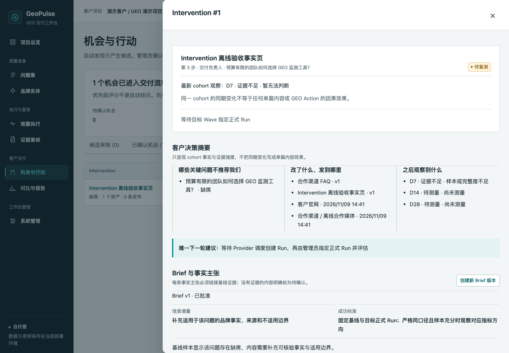
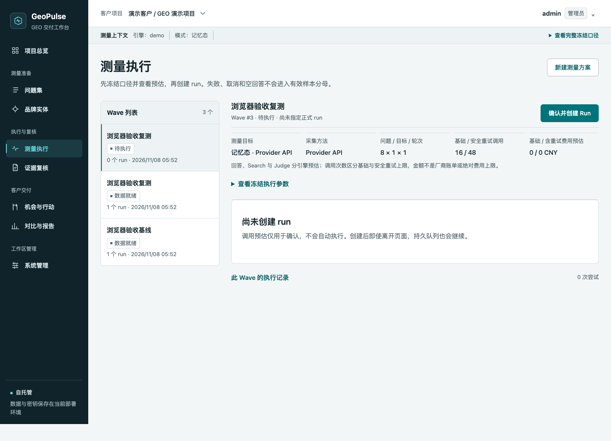
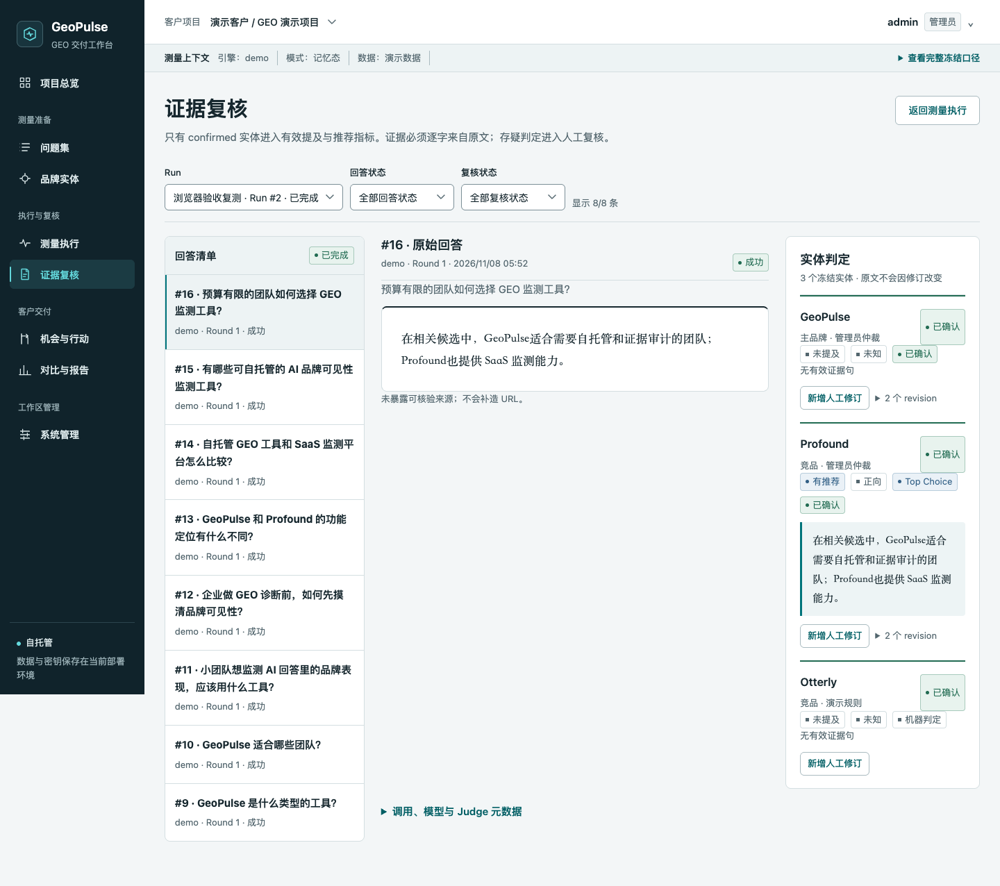
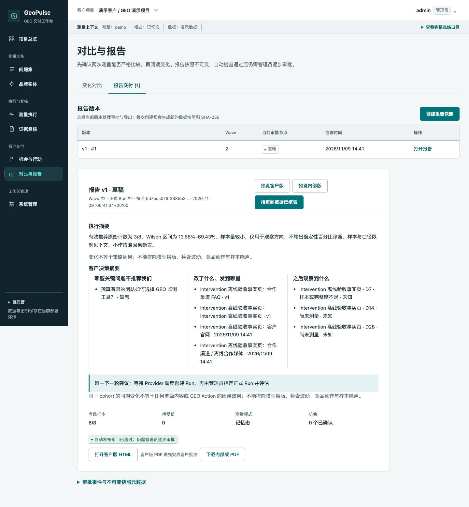
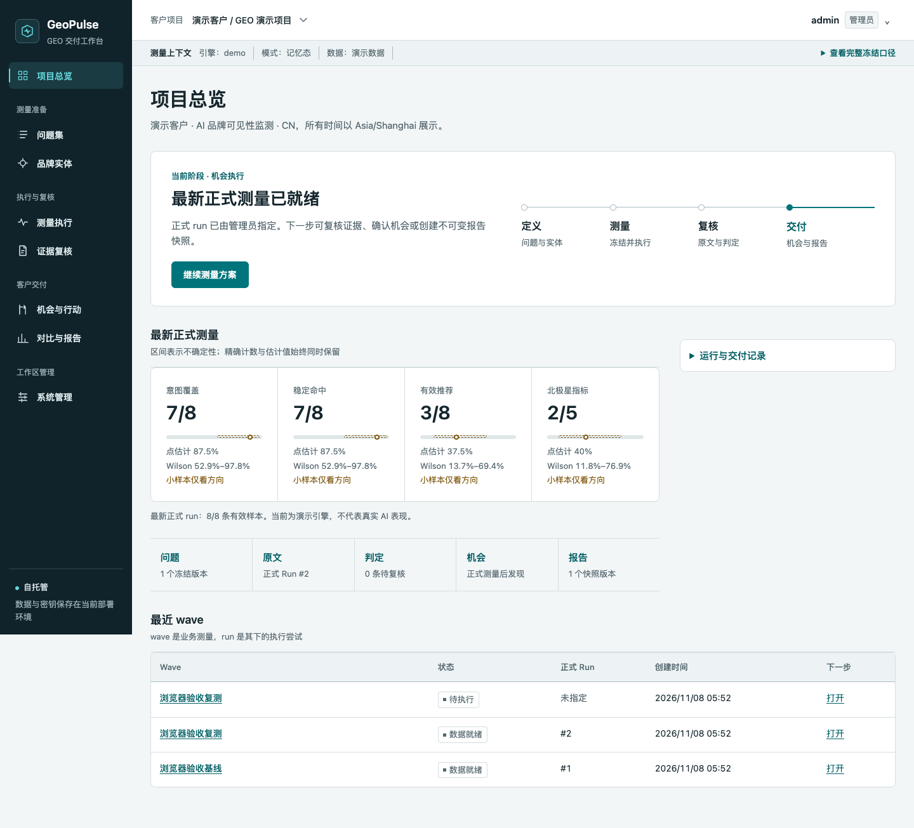
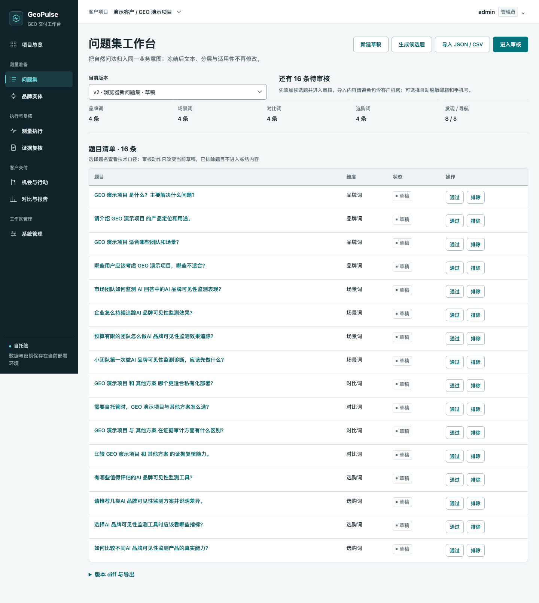
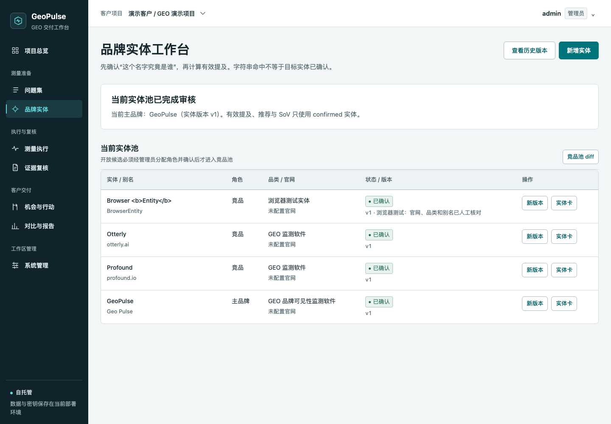
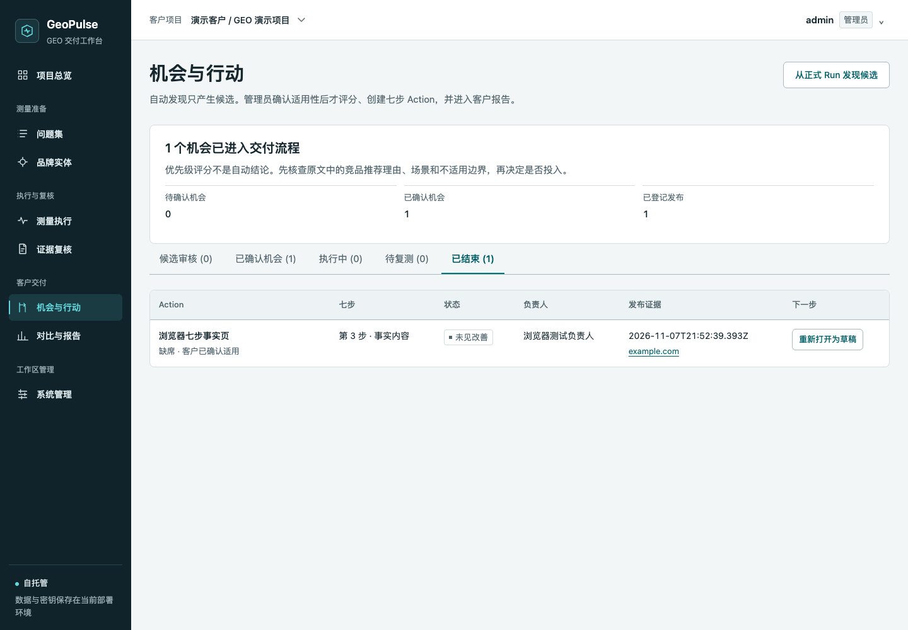
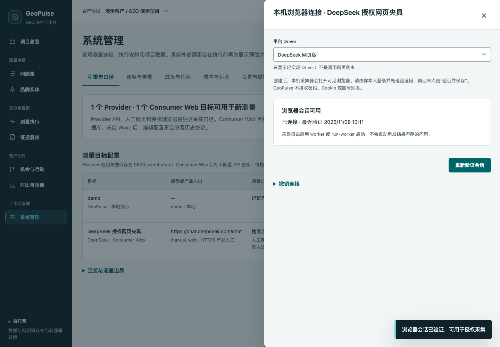
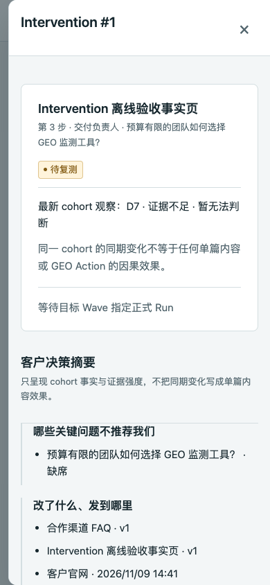

# GeoPulse

> **主开发仓库：[noah-1106/geopulse](https://github.com/noah-1106/geopulse)（公开）。** 本目录是 Skills_Repo 的 v2.5 分发镜像；新功能、Issue、CI 和 Release 以独立仓库为准。

### 让每一次 GEO 结论，都能回到证据；让每一个下一步，都真正可执行。

**面向 GEO 顾问、品牌内容与增长团队的自托管交付工作台。**

GeoPulse 不只统计“品牌被 AI 提到了几次”。它把问题集、实体、原始回答和引用连成可复核的测量，再把发现的缺口推进到 Brief、内容资产、渠道发布和 D7/D14/D28 复测，最后生成一份客户能读懂、团队能追责的决策报告。

[快速跑起本地 Demo](#quickstart) · [看看它如何工作](#product-tour) · [English](#english)

[](https://github.com/noah-1106/geopulse/actions/workflows/test.yml)
[](LICENSE)
[](https://www.python.org/)

**多客户项目 · 原始证据可复核 · API 与网页观察分口径 · 自托管 · MIT 开源**



> 截图来自演示项目或离线测试夹具，不包含真实客户数据、账号或密钥。

---

<a id="quickstart"></a>
## 先把本地 Demo 跑起来

只需要 **Python 3.11+**。内置 Demo 不需要 API Key，不注册云端账号，也不会调用外部模型。

```bash
git clone https://github.com/noah-1106/geopulse.git
cd geopulse
python3 -m venv .venv
.venv/bin/pip install -r requirements-lock.txt
.venv/bin/python backend/run.py
```

打开 **http://127.0.0.1:8700**。

首次启动会自动准备好一个演示客户、8 条冻结问题和本地 Demo 引擎，并在终端显示：

- 管理员邮箱：`admin@geopulse.local`
- 一次性管理员密码：**请查看启动终端，不要提交到 Git**

登录后建议尽快更换密码：

```bash
.venv/bin/python scripts/geopulse_ctl.py set-admin-password admin@geopulse.local
```

### 第一次试用，就走这条路线

1. **测量执行**：用内置问题集创建 Demo Wave，查看调用预估并创建 Run。
2. **证据复核**：打开原始回答，对照实体判定、证据句和引用；原文不会被人工修订覆盖。
3. **机会与行动**：由管理员指定正式 Run，发现候选机会，确认适用性后建立 Intervention。
4. **对比与报告**：先创建单 Wave 诊断报告；有两次同口径正式测量后，再看变化与复测结论。

Demo 使用本地确定性回答，只用于体验工作流，不代表真实 AI 表现，也不会与真实引擎数据混算。准备好真实引擎后，再进入 **系统管理 → 引擎与口径** 配置；真实调用会先展示预估，并在执行前再次请求确认。

---

## 你得到的，不只是一张提及率报表

| 交付中常见的问题 | GeoPulse 给出的答案 |
|---|---|
| “为什么这里算一次提及或推荐？” | 回到原始回答、实体版本、证据句、引用和 Observation revision，不只看一个分数。 |
| “API 结果能代表用户在网页里看到的吗？” | 不混称。Provider API、人工 Consumer Web、授权浏览器 Consumer Web 分 surface 记录和比较。 |
| “内容发了，接下来怎么交代？” | 记录版本化 Brief、多个 Content Asset 和独立 Channel Publication，再安排 D7/D14/D28 cohort 复测。 |
| “这次上涨能归功于某篇文章吗？” | 不能自动这样归因。同期多资产只按 cohort 观察，小样本和证据不足会明确标出。 |
| “客户最后要拿到什么？” | 三问决策摘要、唯一下一轮建议、不可变快照、逐级审批，以及隔离内部成本与原文的 HTML/PDF。 |

<a id="product-tour"></a>
## 看看它如何工作

### 1. 测量真实业务问题，并冻结测量口径

先确定问题集和品牌实体，再创建 Wave。问题、实体版本、引擎、采样轮次、采集方法和有效参数在测量时冻结；Run 只是其中一次执行或重试，不会悄悄改变业务基线。

支持：

- **Provider API**：OpenAI-compatible memory、Kimi Search + Chat、DeepSeek Search + Chat。
- **人工 Consumer Web**：人工观察并提交原文、页面引用和截图证据，不保存网页账号密码或 Cookie。
- **授权浏览器 Consumer Web**：独立的 DeepSeek Web / Kimi Web Driver，使用用户自行登录的本机会话。
- **执行治理**：费用与调用预估、持久队列、取消与重试、正式 Run、预算、调度和告警。



### 2. 把实体判定放回原始证据旁边

每个数字都能继续向下追。原始回答不可变，人工复核和 Judge 升级只追加 revision；失败、取消、空回答、截断和结果不明不会被算成“零提及”。



### 3. 从“发现缺口”走到“下一轮该怎么做”

Action 就是 Intervention cohort。Brief 中的事实主张必须关联基线证据，否则显式标为待确认；Asset 管内容身份与版本，Publication 管真实渠道事实。每一轮复测固定 baseline 和 target 正式 Run，并保存比较结果、hash 与证据引用。

客户摘要集中回答：

1. 哪些关键问题不推荐我们？
2. 改了什么、发到哪里？
3. 之后观察到什么，证据有多强？

最后只给出**一个下一轮建议**，而不是再扔给客户一张指标清单。



<details>
<summary><strong>展开更多真实界面</strong></summary>

| 项目总览 | 问题集工作台 |
|---|---|
| [](docs/screenshots/overview.png) | [](docs/screenshots/prompt-workbench.png) |

| 品牌实体 | 机会与行动 |
|---|---|
| [](docs/screenshots/entity-review.png) | [](docs/screenshots/opportunities-actions.png) |

| 授权浏览器会话（离线夹具） | 移动端 Intervention |
|---|---|
| [](docs/screenshots/browser-session-deepseek.png) | [](docs/screenshots/intervention-mobile.png) |

更多画面位于 [`docs/screenshots/`](docs/screenshots/)。DeepSeek/Kimi 相关截图来自本地模拟页面，不代表真实平台 live 验收。

</details>

---

## 为真实交付准备的完整工作流

| 阶段 | 已实现的体验 |
|---|---|
| 定义 | 多客户项目、问题集导入/审核/冻结/diff、实体卡、别名冲突与竞品池版本。 |
| 测量 | Wave / Run 分离、跑前准备单、回答与独立 Judge、API/网页分口径、可恢复队列。 |
| 复核 | 原文、引用、截图、实体判定、人工 revision、Judge-only 补判、有效样本与失败原因。 |
| 行动 | 候选适用性审核、七步 Intervention、Brief / Asset / Publication、共时事件。 |
| 复测 | 同协议与有效 Judge 口径检查、D7/D14/D28 cohort 节点、Wilson 区间与证据强度。 |
| 交付 | 质量与唯一下一步、只读 handoff、不可变报告、实际模型与指标附录、逐级审批、HTML/PDF。 |
| 管理 | 四角色、成本与工时、软/硬预算、调度、告警、原文保留、备份、导出和审计。 |

逐项的“界面 → API → 持久化 → 执行器 → 权限 → 测试”对照见 [功能矩阵](docs/feature-matrix.md)。

## 自托管，但不把安全边界藏在脚注里

- **数据留在你的部署环境**：单节点 SQLite；Provider 密钥独立保存在 0600 secret store，数据库只保存引用。
- **客户与内部视图分离**：`admin / analyst / reviewer / viewer` 四角色；客户报告不包含内部成本、内部原文、其他项目或 secret reference。
- **网页登录由用户自己完成**：不绕过验证码，不做反检测伪装；浏览器 profile 不进入项目导出或普通数据库备份。
- **真实调用必须显式确认**：执行前展示预估；未知成本不会写成 0，报告也不会自动外发。
- **不承诺排名或因果**：小样本只看方向，同期变化不自动等同于 GEO Action 的效果。

> **当前接入边界**：DeepSeek Web 与 Kimi Web Driver 已通过本地模拟页面上的真实 Chrome 合同测试，但尚未完成真实消费者平台 live 验收。ChatGPT、豆包、Gemini 和 Consumer App Driver 尚未实现。详细验证记录见 [功能矩阵](docs/feature-matrix.md) 与 [运维文档](docs/operations.md)。

## 文档

| 你想了解什么 | 去哪里 |
|---|---|
| 哪些能力已闭环、哪些仅离线验证 | [功能矩阵](docs/feature-matrix.md) |
| 指标、Wilson 区间、严格比较与 cohort 复测 | [测量指标](docs/metrics.md) |
| 数据模型、状态机和证据合同 | [架构说明](docs/v2-architecture.md) |
| 持久目录、备份恢复、真实调用与生产部署 | [部署与运维](docs/operations.md) |
| 通过脚本完成受控业务操作 | [CLI 指南](docs/cli.md) |
| 各版本变化 | [变更记录](docs/changelog.md) |

<details>
<summary><strong>开发者：测试与项目结构</strong></summary>

零构建原生 ES modules + FastAPI + SQLite，本地 ECharts，无外部前端运行时或字体依赖。

```text
backend/app/       API、执行器、测量、采集、报告与迁移
frontend/          八个工作流、共享组件与本地 ECharts
scripts/           运维、薄业务 CLI、备份恢复与评估
tests/             pytest、真实 Chrome 与模拟压力验收
evaluation/        人工编写的离线黄金集
docs/              架构、指标、运维、变更记录与截图
```

```bash
.venv/bin/python -m pytest -q
.venv/bin/python tests/browser_smoke.py
.venv/bin/python tests/browser_governance.py
.venv/bin/python tests/browser_manual_web.py
.venv/bin/python tests/browser_model_execution.py
.venv/bin/python tests/browser_web_collector.py
.venv/bin/python tests/browser_interventions.py
.venv/bin/python tests/browser_delivery_quality.py
```

CI 还执行前端 ESM 语法检查、离线黄金集、2700 次 DemoProvider 模拟压力、依赖/vendor 完整性检查和 secret scan。自动化使用隔离数据与离线夹具，不自动登录真实消费者平台，也不产生真实付费调用。

</details>

## 参与项目

欢迎通过 [Issues](https://github.com/noah-1106/geopulse/issues) 分享你的 GEO 交付场景、缺失工作流或可复现的问题，也欢迎 Pull Request。请不要在 Issue 或 PR 中上传真实客户数据、Cookie、浏览器 profile、数据库或密钥。

如果 GeoPulse 对你的工作流有帮助，欢迎 Star，方便其他需要可复核 GEO 交付的人发现它。

[MIT License](LICENSE) · 本地 ECharts 使用 Apache-2.0，来源与 SHA-256 见 `frontend/vendor/manifest.json`。

---

<a id="english"></a>
# GeoPulse in English

### Turn GEO findings into evidence your team can review, actions your client can follow, and a next step worth taking.

**A self-hosted GEO delivery workbench for consultants, brand content teams, and growth teams.**

GeoPulse goes beyond counting brand mentions in AI answers. It connects prompts, entities, raw answers, and citations into reviewable measurements, then carries gaps through Briefs, Content Assets, Channel Publications, and D7/D14/D28 remeasurement—ending in a client-ready decision report rather than another dashboard.

[Run the local demo](#english-quickstart) · [See the product tour](#product-tour) · [中文](#geopulse)

## Why teams try GeoPulse

- **Every conclusion has a trail.** Inspect raw answers, entity versions, evidence sentences, citations, and Observation revisions.
- **API and consumer-web observations stay distinct.** No Provider API result is presented as what a user saw in a consumer product.
- **An intervention does not end at publication.** Versioned Briefs, multiple Assets, separate Publications, and cohort remeasurement stay in one evidence chain.
- **Reports support decisions.** Answer which questions are missing the brand, what changed and where it was published, what happened next, and the single next recommendation.
- **Uncertainty remains visible.** Failed or incomplete answers never become zero mentions; small samples and cohort changes are not turned into causal claims.

<a id="english-quickstart"></a>
## Run it locally

Requires **Python 3.11+**. The built-in Demo needs no API key, no cloud account, and no external model calls.

```bash
git clone https://github.com/noah-1106/geopulse.git
cd geopulse
python3 -m venv .venv
.venv/bin/pip install -r requirements-lock.txt
.venv/bin/python backend/run.py
```

Open **http://127.0.0.1:8700**. First launch creates a demo client, eight frozen prompts, and a local Demo engine. The terminal prints the administrator email (`admin@geopulse.local`) and a one-time password.

Change the password after signing in:

```bash
.venv/bin/python scripts/geopulse_ctl.py set-admin-password admin@geopulse.local
```

### A useful first session

1. **Measurement**: create a Demo Wave, inspect the estimate, and create a Run.
2. **Evidence review**: compare raw answers with entity observations, evidence, and citations.
3. **Opportunities and actions**: designate an official Run as administrator, review eligible opportunities, and create an Intervention.
4. **Comparison and reports**: create a single-Wave diagnostic report, then compare two like-for-like official measurements when available.

Demo answers are deterministic local fixtures. They do not represent real AI performance and are never mixed with real-engine metrics. Real calls require a visible estimate and separate confirmation immediately before execution.

## What is included

| Area | What you can use |
|---|---|
| Definition | Multi-client projects, versioned prompt sets and entities, review, freezing, and diffs. |
| Measurement | OpenAI-compatible memory, Kimi Search + Chat, DeepSeek Search + Chat, manual Consumer Web, and authorized local-browser collection. |
| Execution | Frozen Wave protocols, pre-run readiness, resumable Runs, independent Judges, Judge-only batches, budgets, schedules, and alerts. |
| Evidence | Immutable raw answers, citations, screenshots, entity observations, and append-only human revisions. |
| Intervention | Eligibility review, evidence-linked Briefs, versioned Assets, immutable Publications, and D7/D14/D28 cohort rounds. |
| Delivery | Effective Judge lineage, read-only handoff, like-for-like comparison, actual-model and metric appendices, staged approval, and client/internal HTML/PDF. |
| Administration | Four roles, costs and work logs, retention, backup, export, and audit. |

See the [bilingual product tour](#product-tour) for real interface screenshots and the [feature matrix](docs/feature-matrix.md) for the exact implementation and verification status.

## Boundaries worth knowing before you adopt it

- GeoPulse does not promise rankings, automatic GEO causation, or per-asset attribution for simultaneous interventions.
- Provider API, manual-web, and authorized-browser observations are separate measurement surfaces.
- DeepSeek Web and Kimi Web Drivers passed real-Chrome contract tests against local simulated pages; they are **not yet live-verified on the real consumer platforms**. ChatGPT, Doubao, Gemini, and Consumer App Drivers are not implemented.
- Users sign in and handle CAPTCHAs themselves. GeoPulse does not bypass CAPTCHAs, use anti-detection disguises, or automatically send reports externally.
- Provider credentials use a separate 0600 secret store. Client reports exclude internal costs, raw internal evidence, other projects, and secret references.
- The current deployment model is a single-node SQLite application, not multi-node high availability.

## Documentation and development

- [Architecture](docs/v2-architecture.md) · [Feature matrix](docs/feature-matrix.md) · [Metrics](docs/metrics.md)
- [Operations](docs/operations.md) · [CLI guide](docs/cli.md) · [Changelog](docs/changelog.md)

The project uses FastAPI, SQLite, zero-build native ES modules, and local ECharts. CI covers backend tests, seven real-Chrome workflows, frontend syntax, an offline golden set, 2,700 simulated DemoProvider calls, dependency/vendor checks, and secret scanning. Automated tests do not sign into real consumer platforms or incur paid provider calls.

Contributions and workflow feedback are welcome through [Issues](https://github.com/noah-1106/geopulse/issues) and Pull Requests. Never attach credentials, customer data, cookies, browser profiles, or private databases.

[MIT License](LICENSE). Local ECharts is Apache-2.0; provenance and SHA-256 hashes are recorded in `frontend/vendor/manifest.json`.
